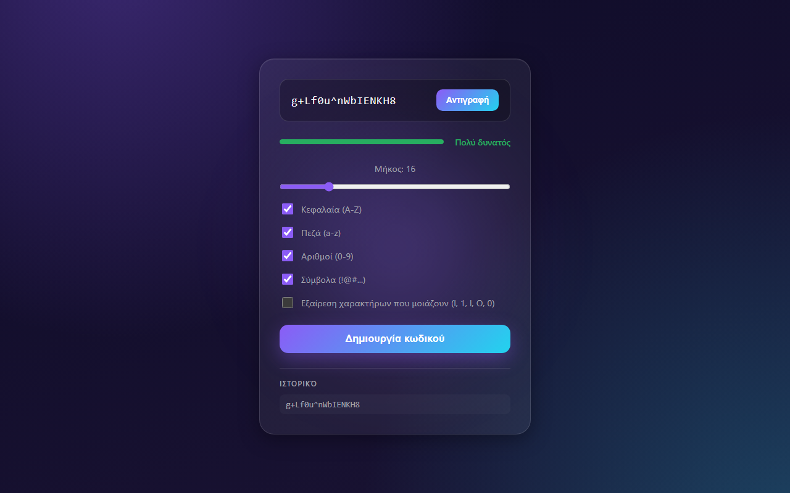

<div align="center">



<br>

[](https://password-generator-two-ruddy-16.vercel.app/)


</div>

<br>



Passwords are generated in your browser with `crypto.getRandomValues`, never `Math.random`. There is no server, no analytics and no network call: the password never leaves the tab.

## Features

- **Cryptographically secure** generation via the Web Crypto API
- Length from 4 to 64, toggles for uppercase, lowercase, numbers and symbols
- Optional exclusion of look-alike characters (`l`, `1`, `I`, `O`, `0`)
- Live strength meter, weak to very strong
- One-click copy with confirmation
- Session history of the last 5 passwords (memory only, gone on refresh)
- Dark glassmorphism UI, fully responsive

## Run locally

```bash
npm install
npm run dev
```

## Stack

| Layer | Tech |
|---|---|
| Framework | React 19 + Vite |
| Styling | Plain CSS, custom properties, glassmorphism |
| Randomness | Web Crypto API |
| Hosting | Vercel |

## License

MIT

<div align="center"><sub>Built by <a href="https://github.com/TPAINN">Apostolos Peiniris</a></sub></div>